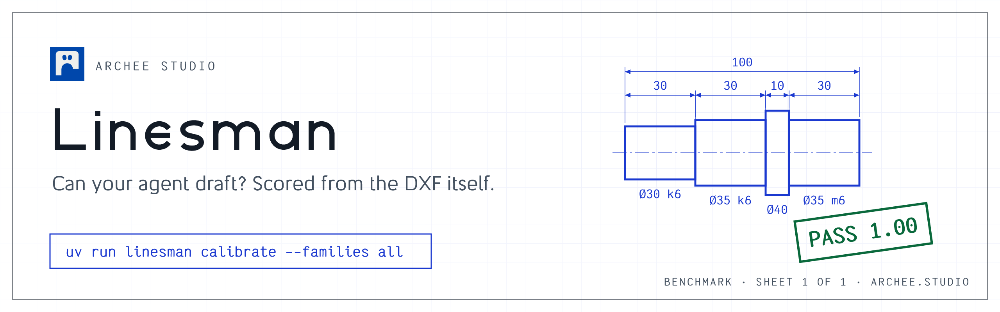

<picture>
  <source media="(prefers-color-scheme: dark)" srcset="assets/banner-dark.png">
  
</picture>

**Can your agent draft?** Linesman gives it an engineering request, takes back one DXF and scores the file itself: views, dimensions, ISO 286 fits and the title block. Any model, agent or CAD tool can enter.

```sh
uv sync
uv run linesman make --family shaft --seeds 5 --out out   # tasks and reference sheets
uv run linesman grade out/tasks out/reference             # score a folder of DXF files
```

Six part families, ten checks, a `review` track for finding seeded errors, and a grader proven on every family. The contract is [docs/spec.md](docs/spec.md).

## For agents

Paste this into your coding agent:

```text
Read AGENTS.md and docs/spec.md in this repository. Then generate 5 shaft tasks, draft a DXF for each, grade them with Linesman and fix every failed check.
```

## Licence

Code Apache-2.0, task data CC BY 4.0. Cite with [CITATION.cff](CITATION.cff).
