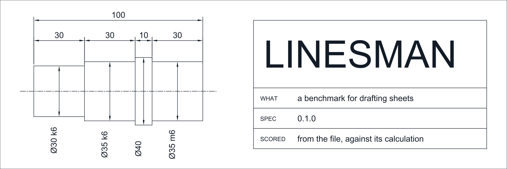

<picture>
  <source media="(prefers-color-scheme: dark)" srcset="assets/banner-dark.svg">
  
</picture>

The banner is a Linesman sheet: the shaft comes from the benchmark's own generator (`tools/banner.py`).

**Linesman scores 2D mechanical drafting sheets against the calculation they came from.** A system receives an engineering request and returns one DXF. Linesman checks that file, not a picture of it: the right views in first-angle projection, every dimension at its value, every fit to ISO 286, and a complete title block. Any agent, model or CAD tool can enter, because only the file is read.

| | |
| --- | --- |
| Tracks | `calc-sheet`: draw a detail sheet from typed parameters. `review`: find the errors seeded in a sheet. |
| Families | plate, shaft, flange, bushing, gear blank, bracket; any seed is a new task |
| Checks | 10, in parts: gate, views, dims, fits, title block, review |
| Grader proof | each check passes correct sheets and their variants, fails its seeded defect, and scores empty sheets near 0 |

## Run it

```sh
uv sync
uv run linesman make --family shaft --seeds 5 --out out    # tasks and their reference sheets
uv run linesman grade out/tasks out/reference              # score a folder of submissions
uv run linesman calibrate --families all --seeds 5         # prove the grader on every family
```

```text
graded 1 tasks: 1 passed, 1 valid
  shaft-0000: pass
```

A task folder holds `task.md` (the request) and `inputs.json` (typed parameters in millimetres). A submission is `sheet.dxf`, or `findings.json` for review tasks. The hidden `truth.json` lists what the sheet must state, never where: any correct layout scores 1.

## How a sheet is scored

1. **Gate.** The file opens, declares millimetres, holds geometry and stays within size and time limits. A failed gate scores every check 0.
2. **Parts.** Each part scores the mean of its checks. A task passes only when every critical check passes.
3. **Reported.** Valid rate, pass rate, score on valid files, score with failures as 0, each part, and the median and worst of three runs.

The full contract, with tolerances and the sheet rules every entrant can read, is [docs/spec.md](docs/spec.md).

## For agents

[AGENTS.md](AGENTS.md) holds the commands, the code map and the rules for changing a check.

## Licence

Code: Apache-2.0. Task data: CC BY 4.0. Cite with [CITATION.cff](CITATION.cff).
